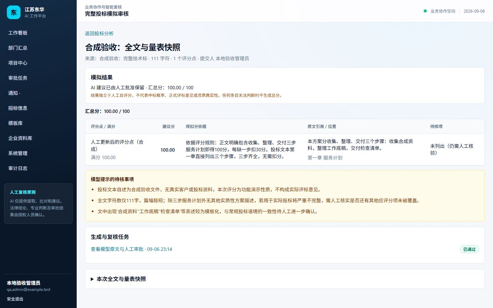
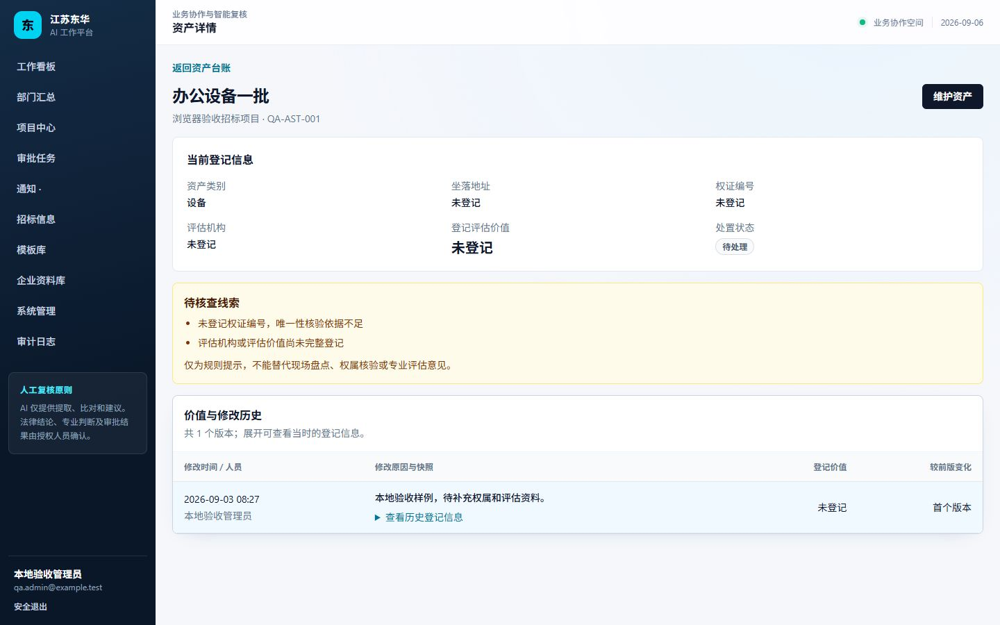
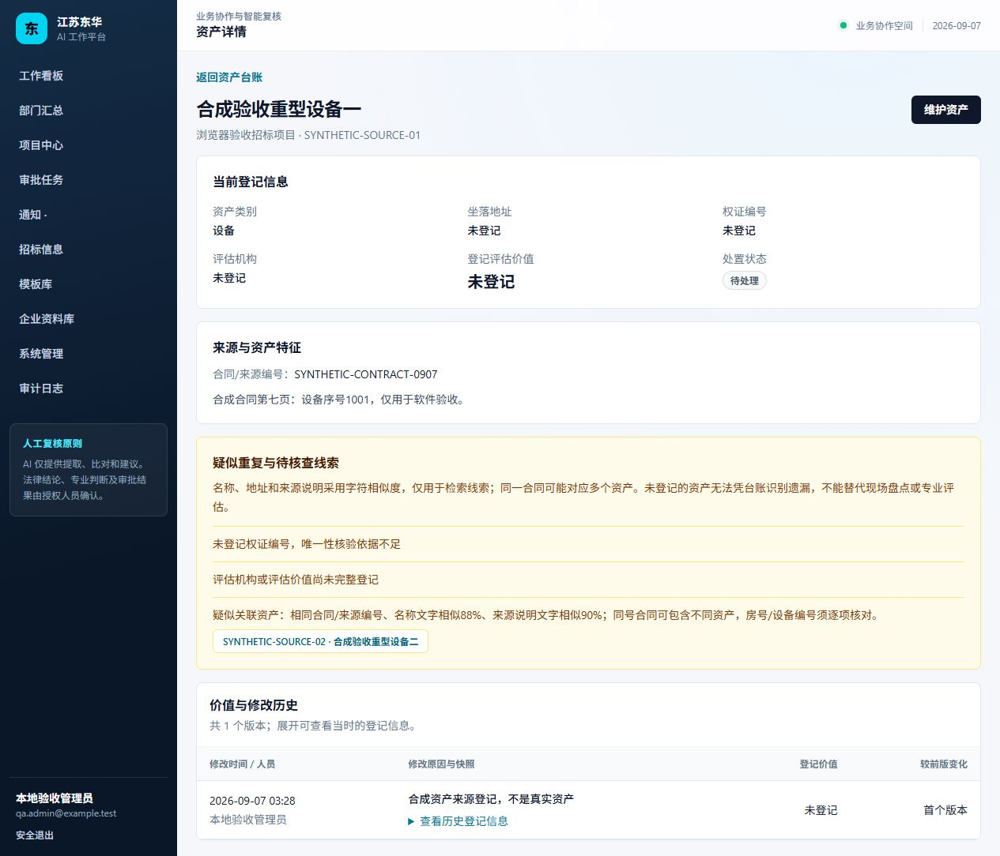
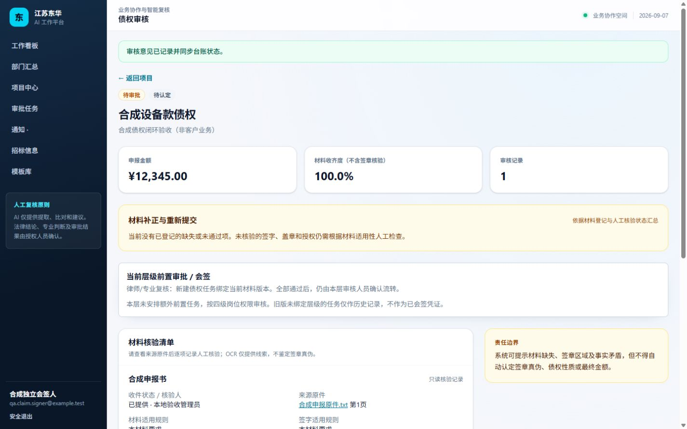
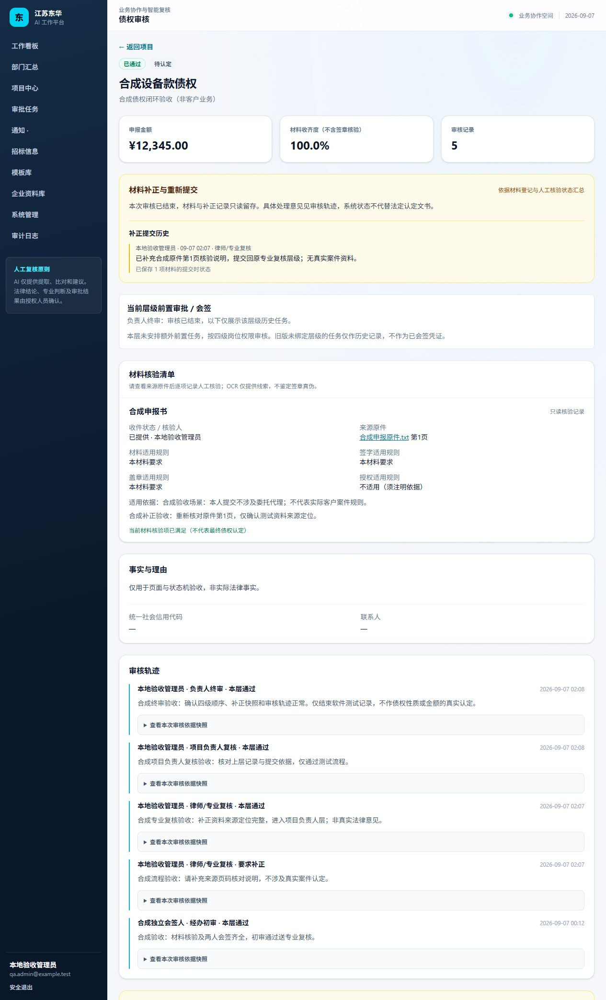
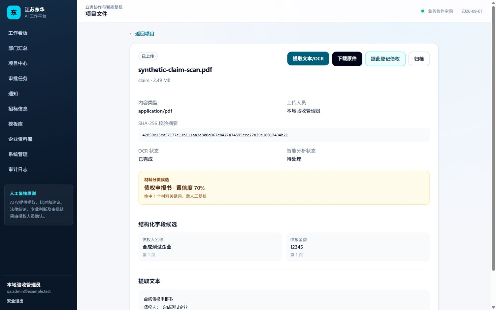
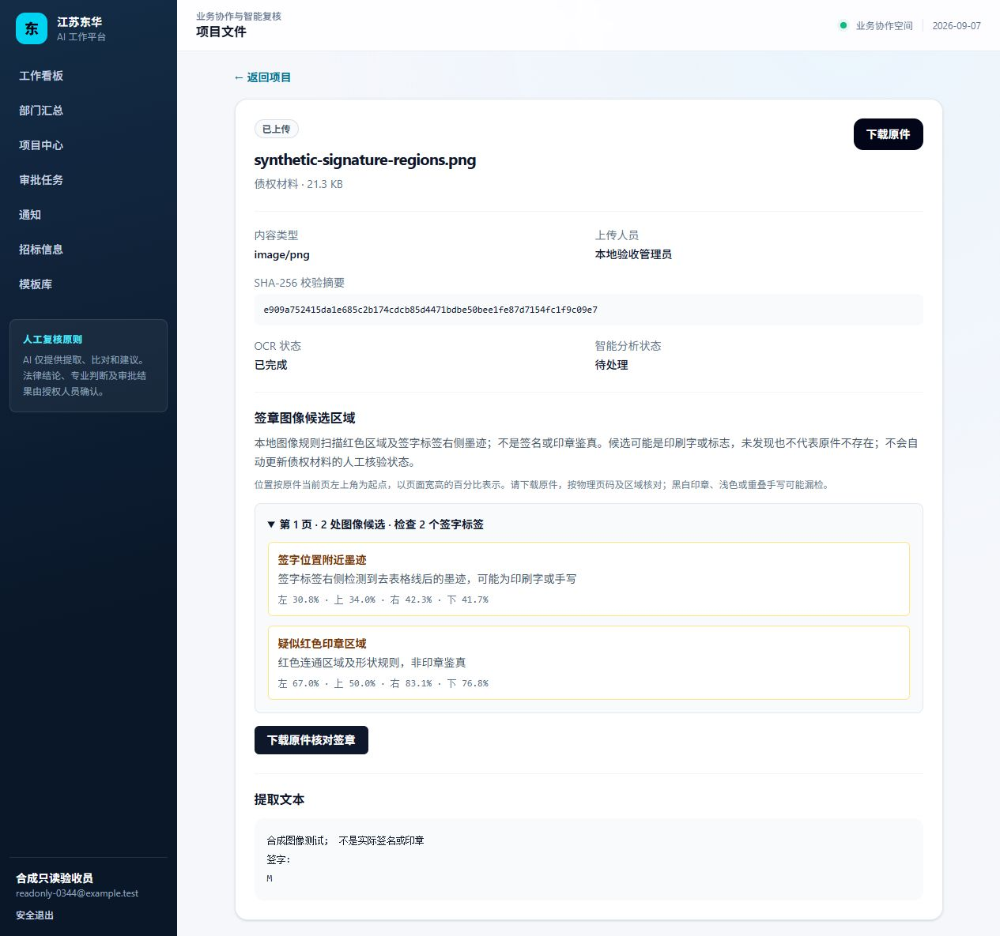
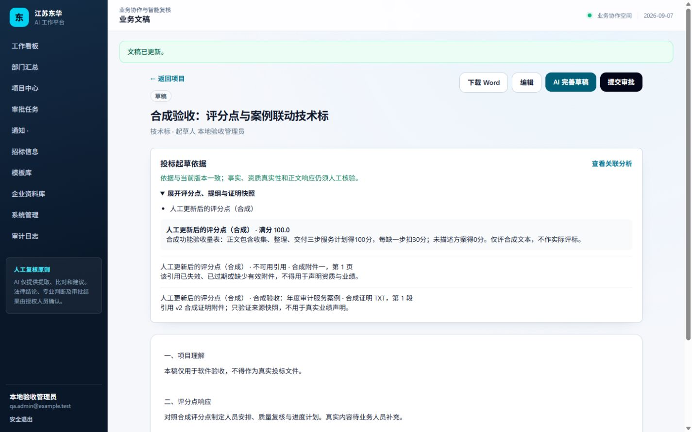
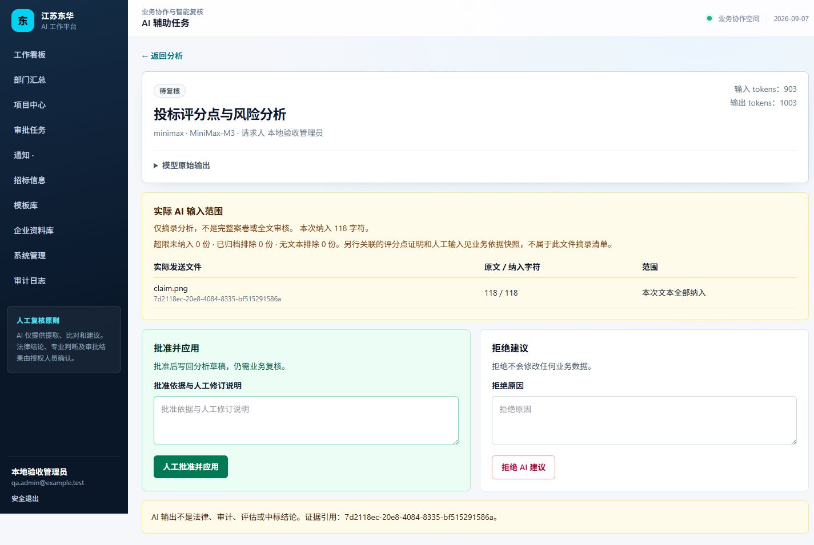
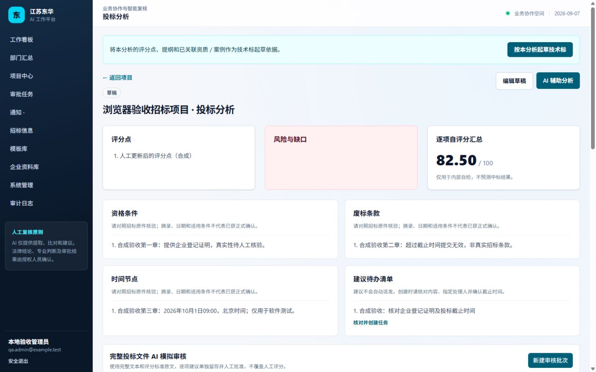

# 江苏东华会计师事务所 AI 工作平台

> **English portfolio overview:** [Enterprise AI Workflow and Audit Platform](docs/PORTFOLIO_CASE_EN.md) - a concise buyer-facing case covering the business problem, implemented system, architecture, verification evidence and production boundaries.

## GitHub 源码版本

本仓库包含主项目完整源码、测试及最新所有者云部署配置，不是加密封装版。当前源码快照上传于 2026-09-23；不含真实 API Key、私有环境配置、数据库、客户附件或独立 CloudBase 部署副本。

- 自有云服务器部署（4核4GB、HTTP 9052 合成数据试用）：[源码部署手册](deploy/owner-cloud/README.md)。公网正式业务应使用 HTTPS。
- [本轮本地验证与未验收边界](deploy/owner-cloud/LOCAL_CHECKS.md)：既有本地测试证据不等于目标云服务器安装、容量及客户验收已通过。
- MiniMax Key 必须通过服务器私有配置注入，不包含在 Git 历史或前端代码中。已有 PyMuPDF 商业授权仍须核对实际部署及分发范围。

面向破产管理、债权审核、招标代理和投标辅助的云优先商业工作平台。

本地交付候选已完成下述实现及分层验证，面向 PC Web，不是仅有静态页面的演示。客户生产上线验收尚未完成：Linux云主机、私有对象存储、TLS和正式业务数据需在客户环境验收；工程审计、资产评估、财务审计的专业规则原文仅列标题，当前提供通用业务框架，不声称已实现未定义的专业引擎。最新证据见 [整体交付记录](docs/ACCEPTANCE_2026-09-07.md)，门禁见 [RELEASE_GATES](docs/RELEASE_GATES.md)，成熟产品对照见 [OPEN_SOURCE_COMPARISON](docs/OPEN_SOURCE_COMPARISON.md)。

## 技术架构

- Rails 8.1 + Ruby 3.4 模块化单体
- Hotwire/Turbo + Stimulus + Tailwind 管理端（保留 ViewComponent 作为复杂组件扩展点）
- PostgreSQL 云生产数据层；本地开发/测试使用 SQLite
- Active Storage 对接阿里云 OSS 或 AWS S3
- Solid Queue 处理 OCR、AI 和外部信息同步任务
- Python worker 负责中文 OCR、PDF 页级解析和可选本地模型

## 本地启动

项目唯一工作目录：`G:\donghua-ai-platform`。本机开发不需要 Docker，也不需要安装 PostgreSQL。

1. 安装 RubyInstaller **Ruby+Devkit 3.4.10 x64**，完成其 MSYS2/编译工具初始化（原生 gem 需要编译依赖），将 Ruby 的 `bin` 目录加入 PATH。下文以安装到 `C:\Ruby34-x64` 为例，其他位置请相应替换。
2. 安装 Bundler：`gem install bundler -v 4.0.20`。进入项目目录，复制 `.env.example` 为 `.env.development.local`，按需配置 AI/OCR；该文件只供开发环境使用，已被 Git 忽略，切勿提交。不要把真实凭据放进会被测试环境加载的通用 `.env`。
3. 冻结安装依赖：`bundle config set --local frozen true`，然后 `bundle install`。不要删除锁文件或自动升级来绕过校验失败；确认网络可访问 RubyGems，首次安装必须联网。
4. 启动：`powershell -ExecutionPolicy Bypass -File .\script\dev.ps1`。可用 `-Port 3100` 指定端口；脚本准备数据库和样式并保持前台运行。
5. 打开 `http://127.0.0.1:3000`，首次进入创建管理员。退出启动终端会同时停止本脚本启动的 Web、样式与定时进程；辅助进程故障也会停止整组，避免误以为提醒仍在运行。

Linux 本地开发需先安装 Ruby 3.4.10、Bundler 4.0.20 和原生编译依赖，冻结安装后运行 `bin/setup --skip-server`，再运行 `bin/dev`。Linux 本地启动脚本已提供但尚未在 Linux 主机实跑；云生产不要使用开发启动器，按 [部署说明](docs/DEPLOYMENT.md) 配置 PostgreSQL、systemd、私有对象存储与 HTTPS。

初始化脚本不会重置已有数据库，拒绝 `--reset` 和 production 环境；已有数据先备份再升级。首次创建管理员支持并发保护，不提供默认通用管理员密码。

OCR 工作进程见 `services/ocr_worker/README.md`，同样直接在本机运行，不使用 Docker。

启动脚本同时管理 Web、样式监听和原生定时进程。定时进程每分钟检查提醒与超时任务，每30分钟同步已启用且已授权的数据源；同目录文件锁防止重复启动。开发环境 AI/OCR 执行仍使用进程内队列，进程中断后由超时检查标为失败并提示人工重试；生产使用持久化 Solid Queue，不能以开发队列代替云端队列。

## 已实现模块

- 首次初始化、登录、部门、用户、角色、项目成员与最小权限
- 项目看板、接管资料、资产台账和业务版本、债权材料/完整度/多级审核
- 文件上传、SHA-256、归档、页级 OCR、材料分类、字段/页码/置信度证据
- 接管多附件、资产重复/缺失风险提示与价值版本变化
- 资产合同/来源编号与特征说明入库、版本快照和检索；同类资产字符相似度与关联链接，不自动合并或下专业结论
- PDF/图片签章图像候选：本地红色区域和签字标签旁墨迹、页码及归一化位置；空白签字线不视为签字，人工核验状态不自动通过
- 债权来源链、候选分析和不可跳级的四级人工审核
- 招标模板版本、占位符生成、授权 JSON 数据源、线索跟进和截止提醒
- 投标评分点/风险/提纲/模拟分、业务文稿和人工审批
- 投标专项清单：资格条件、废标条款、时间节点和建议待办，支持AI提取及人工修订；核对建议后创建真实办理任务，不自动派发或猜测截止日期
- 逐项模拟评分、分值范围与证据检查、自动汇总、缺口阻断复核（仅内部自评，不预测中标）
- 企业资质/案例资料库、有效期与归档、证明附件追加、评分点证据版本快照和受控下载
- 原生 DOCX 下载、中文样式与 Word 自动编号
- OpenAI-compatible AI 适配器、待人工复核、批准写回/拒绝不改数据
- AI任务保存实际输入范围：归档文件不发送，明确摘录截断和遗漏数，文件引用与实际发送一致；投标分析最多6份、文稿8份、债权关联12份，每份20000字符。全文模拟走独立的完整文本路径，不使用此摘录限制
- 通用审批任务、通知、工作流事件、PaperTrail 与不可编辑审计事件
- 部门汇总、已完成招标业务专用视图、按权限下钻项目明细和 CSV 导出
- 完整投标文件 AI 模拟审核：全文与独立量表快照、逐项可读建议、原文引用校验、人工批准后独立留存；单次最多 100000 字符，超限明确拒绝，不修改人工自评分和文稿正文
- 投标分析完整分页与检索，资产只读详情、价值版本与登记快照
- 完整费用台账、组合筛选与分页、只读详情、应收/已收/未收/溢收分别汇总；项目中心分页并保留部门/负责人/截止日期筛选
- 技术标 / 商务标关联本项目投标分析，保存评分点、规则、提纲、资质和案例依据快照；过期/失效证明不用于AI声明事实，依据变化阻断旧文稿审批，核对正文后明确刷新重提

## 模块实拍

以下为本地PC浏览器实拍（包含1440×900视口及默认PC视口的长页截图），全部使用合成验收数据，不含客户资料。截图表示该页面的当前实现，不表示全部交付门禁已通过。

### 完整投标模拟审核

真实 MiniMax-M3 对合成文本生成的逐项建议，经人工核对后独立保存；评分不代表实际评标或中标结论。



### 资产详情与版本记录

登记信息、缺失线索、历史版本与可展开快照；只读成员没有维护入口。



同合同不同设备只提示关联，展示名称/来源说明相似依据，保留两条独立资产和原始登记：



### 债权核验与分层审核

材料收齐与核验分开计量；未确认适用规则不能过审。两人分别会签后仍需经办审核，普通成员无法继续办理专业复核；历史结论保存当时的原始申报、材料和来源摘要。



专业复核退回补正、提交回原层级、逐级终审与终态只读的完整合成轨迹：



### 扫描件提取与来源字段

真实上传合成扫描PDF，经本地EasyOCR工作进程解析后自动轮询展示债权人、金额和物理页码；签章、分类与金额仍须人工核验。Word逻辑位置、Excel工作表位置另作明确标注。



真实合成图片的本地像素检查，候选位置供人工核对原件，不代表签章真实或有效：



### 技术标起草依据

分析页可直接起草技术标；正文与评分规则、资质/案例快照分开呈现。缺原件和失效引用清晰标记，不混同为有效业绩。



### 完整收费台账

组合筛选、全部结果汇总与只读详情。未收与溢收分开显示，不相互抵销；图中均为合成登记，不代表真实交易。


### AI 任务实际输入范围

真实MiniMax返回后展示本次纳入文件、原文字数与实际发送字数，人工可批准或拒绝；缺失和截断部分不冒充已审核。外部服务返回不合法JSON时安全失败，请核对原因后重新发起，不会自动应用。



### 投标专项清单与人工派办

四类专项清单与评分点分区展示；待办入口预填业务对象及内容，由人工选择办理人和截止时间后提交，办理结果有独立轨迹和审计。




## 自动化测试入口

Windows 一键离线门禁（Windows PowerShell 5.1 / PowerShell 7）：

验收工具另外需要 Node.js 22+ 来运行前端确认弹窗的6项无npm依赖白盒测试；网站运行与样式构建本身无需Node。真实浏览器已单独验证确认、取消及Esc，不以这些隔离逻辑测试替代页面测试。

```powershell
powershell -NoProfile -ExecutionPolicy Bypass -File .\script\verify.ps1 -AuditDependencies
```

脚本遇到失败立即退出，不将真实接口跳过算作通过。CI 运行同一套 RSpec，并配置 SQLite/PostgreSQL 双数据库；CI 配置完成不代表远端已运行。

```powershell
C:\Ruby34-x64\bin\ruby.exe bin\rails zeitwerk:check
C:\Ruby34-x64\bin\rspec.bat
C:\Ruby34-x64\bin\rubocop.bat
C:\Ruby34-x64\bin\ruby.exe bin\rails tailwindcss:build
```

完整需求状态、外部接入条件和人工责任边界见 `docs/REQUIREMENTS.md`。

阶段验收与尚未关闭项见 [本地验收记录](docs/ACCEPTANCE_2026-09-06.md)。真实 AI 用例默认跳过；只有在运行进程配置测试凭据并设置 `RUN_LIVE_AI=1` 后才访问指定供应商，不得把跳过计作真实联调通过。

最新的整体门禁推进及债权/会签实测见 [09-07 验收记录](docs/ACCEPTANCE_2026-09-07.md)。

该记录还包含本机原生PostgreSQL双数据库回归、四库隔离、真实持久队列、并发审批与通知去重、独立库和原件恢复证据。生产云的Bucket、TLS和系统服务仍须客户环境验证，不能把本地合成演练当作客户上线验收。

升级涉及数据库迁移时，先停止本项目写入和后台任务、备份数据与附件，再执行迁移，并重启全部 Web/Job 进程；热更新不会可靠刷新旧进程的表结构缓存。详细顺序见 [运维说明](docs/OPERATIONS.md)。

## 云部署

生产环境使用 `DATABASE_URL` 连接阿里云 RDS PostgreSQL 或 AWS RDS PostgreSQL，文件存储通过 S3 兼容接口接入 OSS/S3。密钥通过云 Secret 管理或运行时环境变量注入，不进入仓库和发布包。详见 `docs/DEPLOYMENT.md` 与 `docs/OPERATIONS.md`。

## 给维护人员与后续 AI 的导航

- 业务范围与责任边界：[25项逐项追踪](docs/REQUIREMENT_TRACEABILITY.md)、[需求映射](docs/REQUIREMENTS.md)、[架构](docs/ARCHITECTURE.md)。先读原始需求和当前验收记录，不将历史“已实现”当作已验收。
- 安装与配置：[云部署步骤](docs/DEPLOYMENT.md)、[OCR 独立服务](services/ocr_worker/README.md)、`.env.example`、`deploy/systemd/` 和 `deploy/nginx/`。
- 测试入口：`script/verify.ps1 -AuditDependencies`；`script/http_install_smoke.rb` 只允许专用全新合成安装目录和3111端口；`script/bootstrap_concurrency.rb` / `script/postgresql_concurrency.rb` 只允许专用本机合成库。不要对客户数据运行破坏性测试。
- 运维与恢复：[运维手册](docs/OPERATIONS.md)、[安全边界](docs/SECURITY.md)、[发布门禁](docs/RELEASE_GATES.md)。升级前先备份数据库和原件，迁移后重启 Web/Job，复核健康、任务与授权下载。
- 锁文件包含 Windows、Linux x86_64/ARM64 平台和校验摘要；实际独立安装证据当前仅 Windows。已发现部分 Windows libvips 可选格式插件缺依赖警告，不代表 HEIF/JXL 等格式预览已验证；文档OCR由独立服务处理。

## 完成标准

静态页面、模拟接口和单一测试组不算完成。每个业务功能必须具备真实持久化、权限、审计、后台任务状态、请求测试和可操作页面。
